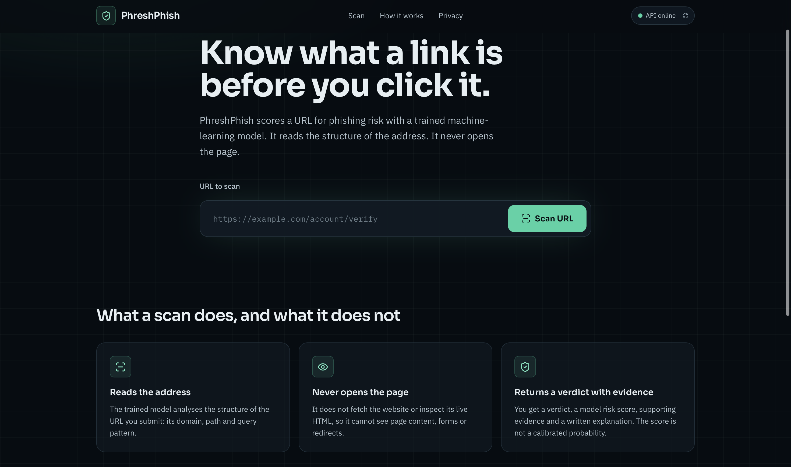
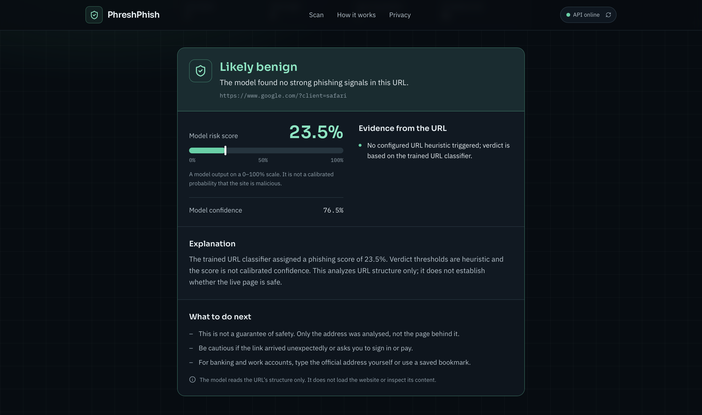

# PhreshPhish — URL Phishing Detection

PhreshPhish is a machine-learning-based web application that analyzes URL structure to estimate phishing risk. It returns a verdict, risk score, confidence field, and explanation to help users make more informed decisions before opening a link.

**Live Demo:** https://phreshphish-frontend.onrender.com

**Backend API:** https://phreshphish.onrender.com

**Backend Repository:** https://github.com/Avanijain09/phreshphish

**API Documentation:** https://phreshphish.onrender.com/docs

## Features

- URL-based phishing risk analysis using a trained machine learning classifier.
- Verdict, model risk score, and confidence display.
- URL structure preview, including host labels, path length, query parameters, and IP-address-host detection.
- FastAPI backend with health-check and prediction endpoints.
- React and TypeScript frontend with a responsive interface.
- Safety guidance explaining the limitations of URL-only analysis.

## Architecture

```text
User
  |
  v
React + TypeScript Frontend
  |
  | HTTP requests
  v
FastAPI Backend
  |
  v
Trained URL Classifier
  |
  v
Prediction Response
  |
  v
Verdict, Risk Score,
Confidence and Explanation
```

The frontend and backend are deployed separately on Render. The frontend communicates with the backend through its HTTP API.

## Technology Stack

- **Frontend:** React, TypeScript, Vite, Tailwind CSS
- **Backend:** Python, FastAPI, Pydantic
- **Machine Learning:** Trained URL classifier, scikit-learn
- **Deployment:** Render
- **Version Control:** Git and GitHub

## API Endpoints

| Method | Endpoint | Purpose |
|---|---|---|
| GET | `/` | API welcome message and endpoint information |
| GET | `/health` | Checks API and model availability |
| POST | `/predict` | Analyzes a submitted URL |
| GET | `/docs` | Interactive API documentation |

### Example Prediction Request

```json
{
  "url": "https://example.com"
}
```

The prediction endpoint returns a structured response containing fields such as the verdict, risk score, confidence, evidence, and explanation. Actual values depend on the submitted URL and the model's output.

## Run the Frontend Locally

### Prerequisites

- Node.js and npm
- Git
- Access to the deployed backend or a locally running backend

### Installation

```bash
git clone https://github.com/Avanijain09/phreshphish-frontend.git
cd phreshphish-frontend
npm install
```

The frontend defaults to the deployed backend API. To override the API URL, create a `.env` file in the frontend root directory:

```env
VITE_API_BASE_URL=https://phreshphish.onrender.com
```

### Start the Development Server

```bash
npm run dev
```

Open the local URL printed by Vite in your terminal.

### Build for Production

```bash
npm run build
```

## Run the Backend Locally

The backend is maintained in a separate repository: [Avanijain09/phreshphish](https://github.com/Avanijain09/phreshphish).

### Prerequisites

- Python 3.11
- Git

### Installation

```bash
git clone https://github.com/Avanijain09/phreshphish.git
cd phreshphish

python3.11 -m venv .venv
source .venv/bin/activate

python -m pip install -r requirements.txt
```

Ensure the trained model artifact is available at:

```text
artifacts/url_token_model_domain_grouped.joblib
```

### Start the API

```bash
uvicorn app.main:app --reload
```

Open http://127.0.0.1:8000/docs to explore the API interactively.

**Note:** These commands follow the backend repository's current README. A clean installation in a fresh environment has not been independently verified here.

## Screenshots

### Homepage



### URL Scan Result



## Limitations

- The application analyzes URL structure and text patterns; it does not visit the website or inspect its live content.
- A benign verdict does not guarantee that a website is safe.
- The risk score is a model output, not a calibrated probability of maliciousness.
- Confidence fields should not be interpreted as calibrated probabilities.
- Evidence may include a generic classifier-based explanation when no configured URL heuristic is triggered.
- Dataset-based evaluation results do not guarantee performance on newly observed URLs or unseen phishing campaigns.
- The application is a research prototype, not a production-hardened security service.

## Future Improvements

- Expand independent evaluation on held-out datasets.
- Report precision, recall, F1-score, and confusion-matrix results clearly.
- Improve prediction evidence using meaningful URL features and explainability methods.
- Validate risk thresholds and calibrate scores.
- Add automated tests and continuous integration.

## Disclaimer

PhreshPhish is a research prototype intended to support phishing awareness. Do not use its predictions as the sole basis for deciding whether a URL is safe.

## License

No project license has been specified yet. Add an appropriate license before permitting reuse or redistribution of the project.
